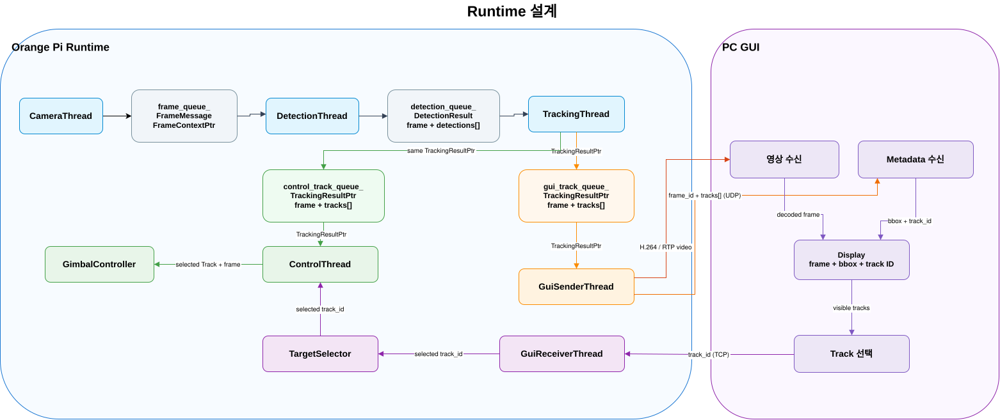

# LWIR DEEPX Tracking Runtime

LWIR 카메라 영상에서 객체를 검출하고 추적한 뒤, 같은 프레임과 Track 결과를 GUI와 짐벌 제어 경로로 전달하는 C++ 런타임입니다.

현재 기준 조합은 다음과 같습니다.

- 입력: `CV_16UC1` LWIR 영상
- Detection: 모델 YAML 기반 YOLOv8/YOLO26 + DEEPX `dx_app` 구조
- Tracking: ByteTrack
- 실행 구조: std::thread + `ThreadSafeQueue`
- 동기화/통신: std::mutex와 POSIX socket API

worker thread와 queue 동기화, socket은 POSIX API를 사용합니다. 프레임과 처리 결과는
`shared_ptr`로 전달하고, 종료 및 실패 상태는 atomic flag로 관리합니다. GStreamer는
영상 pipeline 내부 구현을 위해 GLib을 사용하지만 애플리케이션 worker와 socket의
소유권은 POSIX 경계에 유지합니다.

## 파이프라인



Camera에서 만든 `FrameContext`는 복사하지 않고 `shared_ptr`로 Detection, Tracking, GUI까지 전달합니다. 따라서 GUI는 Track 결과가 생성된 정확한 원본 프레임을 사용할 수 있습니다.

Detection은 `DxAppDetectionPipeline` 한 객체가 전처리, 추론, 후처리를 소유합니다. 별도의 preprocess/inference/postprocess thread는 사용하지 않습니다.

## Applications

### Runtime

실시간 Camera → Detection → Tracking → Target Selection → Control / GUI 전체 파이프라인을 실행합니다.
`gui.enabled`와 `control.enabled` 조합에 따라 실행 결과를 자동으로 구분합니다.

| 구분 | GUI | Control |
| --- | --- | --- |
| `core` | 비활성 | 비활성 |
| `gui` | 활성 | 비활성 |
| `full` | 활성 | 활성 |

GUI 없이 Control만 활성화하는 설정은 허용하지 않습니다. 현재 `deferred` 명령 처리기는
TCP 입력 ID를 제어에 적용하지 않습니다. `tracking` 처리기는 [AUTO 표적 중심 정렬](docs/auto_control.md)과
수동 override를 지원하며 HOME 완료 판정은 미구현입니다. 실제 짐벌/NPU 동작은 별도 검증 대상입니다.
실행 중 `Ctrl+C`를 입력하면 프레임 생산을 멈추고 queue를 순서대로 닫은 뒤 worker를
join하고 측정 결과를 저장합니다.

### Capture

LWIR 카메라 프레임을 Benchmark용 데이터셋으로 저장합니다.

### Benchmark

저장된 모든 sequence의 16-bit PNG를 순차 처리하여 Detection/Tracking prediction과 각 단계의
처리 시간을 저장합니다.

## Build & Run

```bash
# Capture
./scripts/build_capture.sh
./build/capture/lwir_capture

# Benchmark
./scripts/build_benchmark.sh
./build/benchmark/lwir_benchmark

# Runtime
./scripts/build_runtime.sh
./build/runtime/lwir_runtime

# CPU/unit tests
./scripts/build_test.sh

# Runtime output integration check (requires LWIR camera and DEEPX NPU)
./scripts/test_runtime_output.sh
```

Runtime과 Benchmark는 DEEPX 환경을 사용합니다. Capture와 Runtime은 실제 LWIR
카메라 입력을 사용하며, Docker는 개발 및 테스트 환경을 구성할 때 사용할 수 있습니다.

## Dataset

Capture가 생성하는 데이터셋은 sequence 단위로 구성합니다.

```text
<dataset_root>/
├── seq_001/
│   ├── images/
│   │   ├── 000001.png
│   │   ├── 000002.png
│   │   └── ...
│   └── sequence.yaml
├── seq_002/
└── ...
```

`images/`

- TE-EV1에서 저장한 16-bit LWIR PNG frame

`sequence.yaml`

- 촬영 sequence의 조건 및 metadata
- distance, person count, motion, temperature, frame count, image resolution

## Capture → Benchmark

```text
Capture
  ↓
16-bit LWIR Images + Sequence Metadata
  ↓
Benchmark
  ↓
Detection / Tracking Predictions + Timing
```

Benchmark는 설정된 dataset root 아래의 여러 sequence를 읽습니다. Dataset root는
프로젝트 내부의 `datasets/` 또는 외부 저장장치의 `/mnt/lwir_data/datasets/`를 사용할
수 있습니다. 각 sequence는 `000001.png`부터 누락 없이 연속된 frame 이름을 사용해야 하며,
sequence가 바뀔 때마다 Tracker 상태를 초기화합니다.

`config/benchmark.yaml`의 `sequence.range_enabled`가 `false`이면 모든 sequence를 처리합니다.
`true`이면 `sequence.start`부터 `sequence.end`까지 양끝을 포함해 처리합니다. 숫자 순서와
문자열 정렬 순서가 일치하도록 `seq_001`과 같이 zero-padding된 ID를 사용해야 합니다.

## 결과 저장 구조

Benchmark 결과는 model과 tracker 조합 아래에서 실행 시각별로 저장합니다.

```text
/mnt/lwir_data/results/benchmark/
└── yolov8n_bytetrack/
    └── 20261007_190531/
        ├── benchmark.yaml
        ├── yolov8n.yaml
        ├── detections/
        ├── tracks/
        └── timing/
```

Runtime 결과는 실행 모드와 실행 시각으로 구분하고, 모델별 하위 디렉터리에 기록합니다.

```text
/mnt/lwir_data/results/runtime/
└── full/20261007_195105/
        ├── runtime.yaml
        ├── tracking/1.yaml
        └── models/
            ├── 1/
            │   ├── model.yaml
            │   ├── metrics.csv
            │   └── detection_timing.csv
            └── 2/
                ├── model.yaml
                ├── metrics.csv
                └── detection_timing.csv
```

실행 디렉터리는 `YYYYMMDD_HHMMSS` 형식을 사용하며 같은 초에 충돌하면 `_1`, `_2` suffix를
붙입니다. Benchmark는 실패한 실행 디렉터리를 정리합니다. Runtime은 오류 종료에서도
이미 기록한 측정값과 설정 사본을 보존합니다.

Runtime worker는 측정값을 비동기 저장 큐에 전달하며 전체 실행 결과를 벡터에 누적하지
않습니다. 저장 스레드는 128개 기록 또는 1초마다 flush하고, 모델 전환 완료 응답 전과
정상 종료(Ctrl+C/콘솔 quit 포함)에도 flush합니다. A→B→A로 전환하면 A의 기존 파일에
헤더를 중복 작성하지 않고 이어 붙입니다. 세대로 모델을 구분하므로 이전 모델의 늦은
결과도 해당 모델 파일로 갑니다. 행 순서는 프레임 번호 정렬이 아니라 도착 순서입니다.
SIGINT(Ctrl+C), SIGTERM, 콘솔 `quit`는 저장 후 종료합니다. SIGQUIT(`Ctrl+\` 또는
`kill -QUIT <pid>`)은 저장 큐를 폐기하고 **이번 실행 디렉터리 전체를 삭제**한 뒤
worker를 종료합니다. 실행 중 이미 기록한 CSV·설정 사본도 삭제하며 이전 실행은 보존합니다.
SIGQUIT 뒤에 SIGINT나 콘솔 quit가 와도 폐기 종료가 우선합니다.
카메라 시간은 실제 Detection에 제출된 프레임을 해당 모델에 귀속하며, 큐에서 버려지거나
모델 전환 대기 중 소비된 프레임은 모델별 기록에서 제외합니다.

파일 쓰기는 처리 스레드와 분리하며, flush는 OS 버퍼로의 전달까지 보장합니다.
프레임마다 디스크 동기화(fsync)를 수행하지 않으므로 전원 차단 시의 영구 보존은 보장하지
않습니다. 저장 큐는 16,384개로 제한하며 초과 또는 I/O 오류는 무음 누락 대신 runtime
오류 종료로 보고합니다. NPU 및 실제 보드 저장장치에서의 성능은 별도 검증이 필요합니다.

## Configuration

Runtime, Capture, Benchmark는 각각 `config/runtime.yaml`, `config/capture.yaml`,
`config/benchmark.yaml` 설정을 사용합니다. 모델 관련 설정은 `config/model/` 아래의
별도 model configuration으로 관리합니다. 모델의 후처리 조건도 해당 모델 YAML에
포함됩니다. 트래커별 설정은 `config/tracking/` 아래의 YAML로 관리하며 Runtime과
Benchmark의 `tracking_catalog`가 트래커 ID와 설정 파일을 연결합니다.
`tracking.id`로 실행에 사용할 트래커 설정을 선택합니다.
Runtime과 Benchmark는 같은 `config/tracking/bytetrack.yaml`을 참조합니다.
runtime 내부의 `request_tracker_change(id)`는 변경 요청을 큐에 넣고 실행 루프가 처리합니다.
새 인스턴스를 먼저 만든 뒤 활성 트래커를 교체하며, 진행 중이던 프레임이 끝나면 이전
인스턴스가 소멸합니다. TCP 5002의 Pipeline(category=4) 명령으로 모델·트래커 개수를
조회하고 전환을 요청할 수 있습니다. 카탈로그 ID는 각각 1부터 연속이어야 합니다.
패킷과 접수·완료 응답 형식은 [PC 통신 계약](docs/pc_communication.md)에 정의되어 있습니다.

- Runtime 측정 결과 root: `measurement.output_root`
- Capture dataset root와 sequence: `path.dataset_root`, `sequence.id`
- Benchmark sequence 범위: `sequence.range_enabled`, `sequence.start`, `sequence.end`
- Benchmark dataset/result root: `path.dataset_root`, `path.output_root`
- Runtime/Benchmark model 설정: `model.config`

테스트용 터미널 명령은 `lwir_runtime config/runtime.yaml --console`로 활성화합니다.
`model 2`, `tracker 1`은 기존 전환 경로로 요청을 전달하고 접수·완료 결과를 출력합니다.
`count`는 모델·트래커 개수, `help`는 사용법, `quit`는 정상 종료를 요청합니다.
콘솔 ID는 카탈로그의 1부터 시작하는 ID입니다. EOF는 입력만 비활성화하며 runtime은
계속 동작합니다. 옵션을 생략하면 표준 입력을 읽지 않습니다.

Runtime–PC 통신은 [PC 통신 계약](docs/pc_communication.md)을 따릅니다.
GUI 성능 통계는 [Runtime telemetry](docs/runtime_telemetry.md)를 참고합니다.
`gui.metadata.telemetry.enabled`는 기본 `true`이며, LWTM 확장을 지원하는 PC 앱이 필요합니다.
GUI 키보드 수동 제어와 AUTO는 [통합 제어 설정·시험](docs/auto_control.md)을 참고합니다.
고정 IP와 직결 LAN·Windows 수신 방화벽 설정은 [네트워크 설정](docs/network_setup.md)을 참고합니다.
통신 형식은 PC 규격으로 고정합니다. `gui.command.handler`는 AppConfig가 검증하고
팩토리가 명령 처리 전략을 생성합니다. 기본 `deferred` 처리기는
PING/상태 응답만 제공합니다. `manual` 처리기는 Waveshare Serial 수동 방향 제어와
연결 단절·heartbeat 정지를 담당합니다. AUTO 추종은 추후 구현합니다.

## 현재 구현 상태

- 구현됨: thread/queue 연결, shared Frame 수명 관리, LWIR 전처리, 설정 검증,
  ByteTrack, GUI/제어 결과 분기
- 구현됨: `core`/`gui`/`full` 구분, Runtime/Benchmark 결과 snapshot과 실패 시 정리,
  Runtime stage 측정, `Ctrl+C` 정상 종료
- 구현됨: GStreamer `x264enc` 기반 H.264/RTP/UDP 영상 송신, 별도 Track
  metadata UDP 송신, GUI 송신 시작 timestamp 전달, GUI TCP 명령 수신·재접속·종료 처리
- 구현됨(하드웨어 미검증): i3system Thermal Expert SDK 카메라 입력
- 골격 상태: DEEPX NPU 추론·후처리, Orange Pi 하드웨어 H.264 encoder,
  짐벌 통신

논의가 필요한 항목은 [Discussion](discussion.md)에서 확인할 수 있습니다.

## Test

```bash
./scripts/build_test.sh
```

필요하면 생성된 `build/test` 디렉터리에서 특정 CTest만 직접 실행할 수 있습니다.
